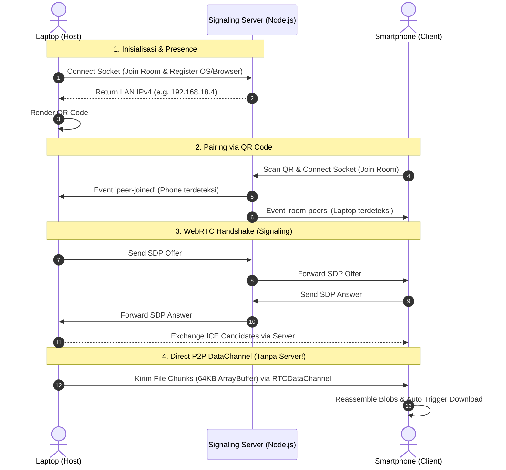

# ⚡ VanCross: Cross-Device P2P File Transfer & Screen Hub

> **High-Performance, Zero-Cloud P2P File & Screen Sharing over Local Network (WebRTC + WebSockets)**

[](https://react.dev/)
[](https://vitejs.dev/)
[](https://webrtc.org/)
[](https://socket.io/)
[](https://tailwindcss.com/)

---

## 📌 Problem & Motivation

Berbagi file besar (video, gambar beresolusi tinggi, dokumen) antar perangkat berbeda sistem operasi (Windows $\leftrightarrow$ Android / iPhone / macOS) biasanya memerlukan:
1. **Cloud Drive (Google Drive / Telegram):** Menghabiskan kuota internet dua kali (upload lalu download), memakan waktu, dan memiliki batasan privasi.
2. **Kabel Data / Flashdisk:** Merepotkan dan membutuhkan adaptor OTG.
3. **Ekosistem Tertutup (AirDrop / Quick Share):** Terbatas hanya untuk perangkat bermerek sama.

**VanCross** memecahkan masalah ini dengan menghadirkan solusi berbasis browser **tanpa install aplikasi**, **tanpa akun**, dan **tanpa menyimpan file di server**. File dan video layar dikirimkan langsung dari memori perangkat pengirim ke penerima (**Peer-to-Peer**) melalui protokol **WebRTC**.

---

## 🚀 Fitur Utama

- 📱 **Instant Mobile Pairing via QR Code:** Buka kamera HP, scan QR code di layar laptop $\rightarrow$ langsung terhubung dalam hitungan detik.
- ⚡ **P2P Bi-Directional File Transfer:** Kirim file ukuran berapa pun bolak-balik antara HP dan Laptop dengan kecepatan lokal Wi-Fi (bisa mencapai puluhan MB/s).
- 🔄 **Backpressure & Streaming Control:** Menggunakan chunking 64KB dan pemantauan `bufferedAmount` agar browser tidak kehabisan memori (*out of memory*) saat mengirim file berukuran besar.
- 📋 **Quick Text & Clipboard Sync:** Bertukar tautan URL, catatan, atau teks secara instan dengan satu tombol *"Salin ke Clipboard"*.
- 🖥️ **Live Screen Monitoring / Screen Share:** Bagikan tampilan layar laptop ke HP (atau sebaliknya) secara realtime dengan latensi ultra-rendah melalui WebRTC MediaStream.
- 🔒 **End-to-End Privacy:** File tidak pernah mampir ke harddisk server.

---

## 🏗️ Arsitektur Sistem



---

## 🛠️ Tech Stack & Konsep Rekayasa

| Layer | Teknologi | Konsep yang Diterapkan |
| :--- | :--- | :--- |
| **Networking Core** | WebRTC DataChannel & MediaStream | NAT Traversal, STUN, ICE Candidates, SCTP Protocol |
| **Signaling & Presence**| Node.js, Express, Socket.IO | Real-time bi-directional events, Room state, LAN IP discovery |
| **Frontend** | React 19, Vite, Tailwind CSS v4 | Responsive mobile-first UI, Drag & Drop, Canvas QR Code |
| **Data Streaming** | JavaScript ArrayBuffer & Blob API | Memory chunking (64KB), Backpressure management (`bufferedAmountLow`) |

---

## 💻 Cara Menjalankan Proyek di Lokal

### 1. Prasyarat
- Node.js versi 18+ (Disarankan versi 20+).
- Komputer dan Smartphone terhubung ke **jaringan Wi-Fi yang sama** (atau tethering hotspot).

### 2. Menjalankan Server & Klien

Buka terminal di root direktori proyek (`vancross`):

**Opsi A (Menggunakan start script):**
```cmd
start.bat
```

**Opsi B (Manual):**

Terminal 1 (Backend Signaling Server):
```bash
cd server
npm start
```
*Server akan berjalan di port `3001` dan mendeteksi IP lokal Anda.*

Terminal 2 (Frontend Client):
```bash
cd client
npm run dev
```
*Vite akan berjalan di port `5173` dengan flag host aktif.*

### 3. Penggunaan
1. Buka browser di laptop: `http://localhost:5173`
2. Klik tombol **Hubungkan HP (QR)**.
3. Arahkan kamera smartphone ke QR Code tersebut.
4. Perangkat Anda akan langsung saling mengenali di layar, dan Anda siap mentransfer file atau berbagi layar!

---

## 📱 Build Aplikasi Native Android (Capacitor & CI/CD)

Proyek ini telah dikonfigurasi dengan **Capacitor Android** sehingga dapat menghasilkan aplikasi Android asli (.apk).

### Opsi 1: Build Otomatis di Cloud (GitHub Actions CI/CD)
Tidak perlu menginstal Android Studio di laptop:
1. Push repositori ini ke GitHub.
2. Tab **Actions** di GitHub akan secara otomatis meng-compile file APK via workflow [build-apk.yml](.github/workflows/build-apk.yml).
3. Unduh file `VanCross-Android-APK` langsung dari GitHub Artifacts dan pasang di HP Anda!

### Opsi 2: Build di Lokal (Jika memiliki Android Studio)
```bash
# 1. Build frontend & sinkronisasi ke project Android
npm run build:android

# 2. Buka project di Android Studio
cd client
npx cap open android
```
Di Android Studio, pilih menu **Build > Build Bundle(s) / APK(s) > Build APK(s)**.

---

## 👨‍💻 Author & Portofolio
Dibuat sebagai proyek rekayasa fullstack & networking modern untuk demonstrasi arsitektur sistem real-time terdistribusi.
