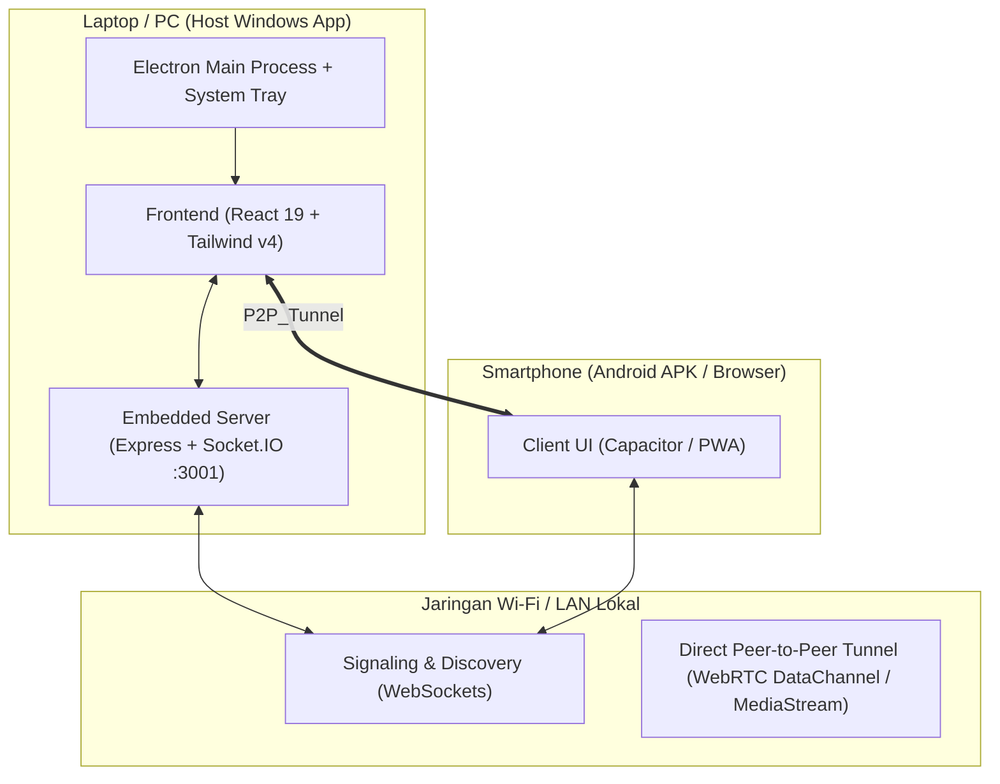

# ENCross

> Projek yang saya buat sendiri untuk membantu sehari-hari.

[](https://react.dev/)
[](https://vitejs.dev/)
[](https://webrtc.org/)
[](https://www.electronjs.org/)
[](https://capacitorjs.com/)
[](https://socket.io/)
[](https://tailwindcss.com/)
[](LICENSE)

---

## Latar Belakang

Berbagi file berukuran besar (video, arsip ZIP, foto resolusi tinggi, dokumen) atau berbagi layar antar perangkat dengan sistem operasi berbeda (**Windows** $\leftrightarrow$ **Android / iOS / macOS**) umumnya menghadapi kendala:
1. **Layanan Cloud Drive (Google Drive, Telegram, WhatsApp):** Menghabiskan kuota internet dua kali (*upload* lalu *download*), memakan waktu lama, memiliki batasan ukuran file, dan menimbulkan kekhawatiran privasi data.
2. **Kabel Data & Flashdisk:** Kurang fleksibel dan memerlukan adaptor OTG atau kabel fisik.
3. **Ekosistem Tertutup (AirDrop / Quick Share):** Terbatas hanya pada vendor atau ekosistem perangkat tertentu.

**ENCross** memecahkan masalah ini dengan menghadirkan solusi transfer lokal berkecepatan tinggi:
- **Zero Cloud Storage:** File dialirkan langsung dari memori perangkat pengirim ke perangkat penerima (**Peer-to-Peer**) melalui protokol **WebRTC DataChannel**.
- **Tanpa Akun & Tanpa Login:** Cukup buka aplikasi atau scan QR Code di jaringan Wi-Fi/LAN yang sama.
- **Cross-Platform:** Tersedia sebagai aplikasi desktop **Windows** (Electron), aplikasi mobile **Android** (Capacitor APK), serta web browser (**PWA**).

---

## Fitur Utama

### 1. Transfer File P2P Berkecepatan Tinggi
- Memanfaatkan **WebRTC RTCDataChannel** dengan chunking memori 64KB dan mekanisme *backpressure flow control* (`bufferedAmountLow`).
- Kecepatan transfer memanfaatkan throughput penuh Wi-Fi LAN lokal tanpa terpengaruh kecepatan internet.
- Mendukung pengiriman file berukuran besar tanpa risiko kehabisan memori (*out of memory*).

### 2. Pairing Cepat via QR Code & Auto-Close
- Laptop menampilkan QR Code yang memuat alamat IP lokal.
- Cukup scan menggunakan kamera smartphone; begitu koneksi tersambung, modal QR Code di laptop otomatis tertutup (*auto-close*).
- Opsi langsung untuk mengunduh file APK Android langsung dari laptop via LAN atau melalui GitHub.

### 3. Sinkronisasi Teks & Clipboard Interaktif
- Mengirim catatan atau tautan web seketika antar perangkat.
- Dilengkapi pop-up notifikasi yang tidak mengganggu:
  - Tombol **"Buka"** untuk melihat riwayat pesan.
  - Tombol **"Salin"** untuk menyalin teks langsung ke clipboard.
  - Deteksi URL otomatis dengan tombol langsung **"Buka Link"**.

### 4. Berbagi Layar Real-Time (Screen Share)
- Berbagi layar laptop ke layar smartphone (atau sebaliknya) secara langsung dengan latensi ultra-rendah melalui **WebRTC MediaStream**.
- Terintegrasi dengan Electron `desktopCapturer` untuk tangkapan layar desktop yang mulus.

### 5. Aplikasi Desktop Windows
- Dibangun dengan **Electron**, dilengkapi embedded in-process server Express & Socket.IO.
- Berjalan di latar belakang (**System Tray**) tanpa mengganggu kerja.
- Shortcut `ENCross.lnk` otomatis dibuat di Desktop.

### 6. Aplikasi Android Native & PWA
- Dapat diinstal sebagai aplikasi native Android (`ENCross.apk`) melalui Capacitor.
- Dapat juga diakses langsung dari browser smartphone mana pun tanpa instalasi (PWA).

---

## Arsitektur & Alur Kerja Sistem

### 1. Diagram Alur Koneksi & Transfer Data (Sequence Diagram)

```mermaid
sequenceDiagram
    autonumber
    actor Laptop as Laptop (Host - Windows App)
    participant Server as Embedded Signaling Server (Node.js/Socket.IO)
    actor Phone as Smartphone (Client - Android / Browser)

    Note over Laptop,Server: 1. Inisialisasi & Presence Jaringan LAN
    Laptop->>Server: Inisialisasi Embedded Server di Port 3001
    Laptop->>Server: Socket Join Room & Daftarkan Profil Perangkat
    Server-->>Laptop: Kembalikan Alamat IP Lokal (misal: 192.168.1.10)
    Laptop->>Laptop: Tampilkan QR Code Berisi URL Pairing

    Note over Phone,Laptop: 2. Pairing & Auto-Close Modal
    Phone->>Server: Scan QR / Buka URL & Join Room
    Server->>Laptop: Event 'peer-joined' (Smartphone Terdeteksi)
    Laptop->>Laptop: Tutup Otomatis Modal QR Code!
    Server->>Phone: Event 'room-peers' (Daftar Perangkat Online)

    Note over Laptop,Phone: 3. WebRTC Signaling Handshake
    Laptop->>Server: Kirim SDP Offer
    Server->>Phone: Teruskan SDP Offer
    Phone->>Server: Kirim SDP Answer
    Server->>Laptop: Teruskan SDP Answer
    Laptop<<-->>Phone: Pertukaran ICE Candidates via Signaling Server

    Note over Laptop,Phone: 4. Direct P2P DataChannel (Zero Cloud / Memori Langsung)
    Laptop->>Phone: Stream File Chunks (64KB ArrayBuffer) via RTCDataChannel
    Phone->>Phone: Rakit Blob Memori & Trigger Unduhan Otomatis
```



### 2. Diagram Topologi Komponen



---

## Tech Stack

| Komponen | Teknologi | Penjelasan Teknis |
| :--- | :--- | :--- |
| **Networking Core** | WebRTC DataChannel & MediaStream | NAT Traversal LAN, STUN/ICE Candidates, SCTP Protocol, Chunking 64KB |
| **Signaling & Presence** | Node.js, Express 5, Socket.IO 4 | Real-time bi-directional events, Room state, LAN IP discovery, Hardware deduplication |
| **Desktop Platform** | Electron 44, electron-builder | In-process embedded server, System Tray, Desktop shortcut auto-creation, desktopCapturer |
| **Mobile Platform** | Capacitor 7, Android SDK 36 | Native Android runtime, splashscreen, local assets sync |
| **Frontend Framework**| React 19, Vite 8, Tailwind CSS v4 | Component-based, hooks, touch-friendly tactile UI, QR SVG generation |
| **Feedback UX** | Web Audio API, Vibration API | Haptic tactile feedback & notifikasi audio native |

---

## Struktur Direktori Proyek

```text
encross/
├── client/                     # Frontend Web & Mobile Application (React + Vite)
│   ├── android/                # Native Android Project (Capacitor + Gradle)
│   │   └── app/build/outputs/  # Lokasi file ENCross.apk hasil build
│   ├── public/                 # Aset statis & APK download bundle
│   └── src/
│       ├── components/         # Komponen UI (Navbar, Radar, Drawer, Modals)
│       ├── utils/              # WebRTC Manager, Device Info, Audio Feedback
│       └── App.jsx             # State orchestration & event routing
├── desktop/                    # Electron Desktop Application
│   ├── assets/                 # Ikon aplikasi & system tray
│   ├── main.js                 # Electron main process & desktop shortcuts
│   ├── preload.js              # IPC bridge API
│   └── server.js               # Embedded in-process Express & Socket.IO server
├── release/                    # Hasil kompilasi binary Windows & Android
│   ├── ENCross 1.0.0.exe       # Versi Windows Portable
│   ├── ENCross Setup 1.0.0.exe # Versi Windows NSIS Installer
│   └── ENCross.apk             # Versi Android APK
├── server/                     # Standalone Node.js signaling server (opsional untuk dev)
├── package.json                # Root build scripts & electron-builder configuration
└── README.md                   # Dokumentasi teknis proyek
```

---

## Panduan Penggunaan & Instalasi

### Opsi 1: Menjalankan Aplikasi Siap Pakai (Recommended)

1. **Pengguna Windows:**
   - Jalankan installer: `release/ENCross Setup 1.0.0.exe` atau jalankan langsung versi portable: `release/ENCross 1.0.0.exe`.
   - Aplikasi otomatis membuat shortcut **ENCross** di Desktop Anda dan aktif di latar belakang (System Tray).
2. **Pengguna Android:**
   - Pasang file `release/ENCross.apk` di HP Android Anda, atau cukup scan QR Code di aplikasi desktop untuk mengunduh APK secara langsung melalui jaringan Wi-Fi LAN.

---

### Opsi 2: Menjalankan dari Source Code (Local Development)

#### Prasyarat:
- [Node.js](https://nodejs.org/) versi 18+ (Disarankan versi 20+).
- Komputer dan Smartphone berada di **jaringan Wi-Fi/LAN yang sama** (atau tethering hotspot).

#### Langkah Menjalankan:
```bash
# 1. Clone repositori
git clone https://github.com/EdvanVPRoject/ENCross.git
cd ENCross

# 2. Install dependensi root & client
npm install
cd client && npm install && cd ..

# 3. Jalankan aplikasi desktop dalam mode development
npm run desktop:dev
```

---

### Cara Build Mandiri

#### 1. Build Executable & Installer Windows (.exe)
```bash
npm run desktop:dist
```
*Hasil file installer (`ENCross Setup 1.0.0.exe`) dan portable (`ENCross 1.0.0.exe`) akan otomatis tersimpan di folder `release/`.*

#### 2. Build APK Android (.apk)
```bash
# 1. Build aset web dan sinkronisasikan ke Capacitor Android
cd client
npm run build:android

# 2. Compile APK menggunakan Gradle
cd android
./gradlew assembleDebug
```
*Hasil file `app-debug.apk` akan berada di `client/android/app/build/outputs/apk/debug/`.*

---

## CI/CD Automation (GitHub Actions)

Proyek ini telah dilengkapi pipeline otomatisasi GitHub Actions:
- Setiap kali Anda melakukan `git push` ke branch `main` atau `master`, workflow [.github/workflows/build-apk.yml](.github/workflows/build-apk.yml) akan secara otomatis mengompilasi file **ENCross Android APK** di cloud dan menyediakannya di tab **GitHub Actions Artifacts**.

---

## Pengembang

Proyek ini dirancang dan dikembangkan secara mandiri oleh:

**Edvan Nuriana Putra Septia**  
*Lulusan S1 Sistem Komputer — Universitas Komputer Indonesia (UNIKOM)*  
*Spesialisasi: IoT, Computer Vision, Embedded Systems, & Fullstack Networking.*

- **GitHub:** [https://github.com/EdvanVPRoject](https://github.com/EdvanVPRoject)
- **LinkedIn:** [https://linkedin.com/in/edvannuriana](https://linkedin.com/in/edvannuriana)

---

## Panduan Pengembangan Lanjutan & Kontribusi

Proyek ini terbuka bagi siapa saja yang ingin mempelajari, menambahkan fitur baru, atau mengembangkannya lebih jauh.

### Alur Kontribusi
1. **Fork** repositori ini ke akun GitHub Anda.
2. Buat branch baru untuk fitur atau perbaikan Anda:
   ```bash
   git checkout -b feature/nama-fitur
   ```
3. Lakukan commit perubahan Anda dengan pesan yang deskriptif:
   ```bash
   git commit -m "feat: deskripsi perubahan fitur"
   ```
4. Push branch ke repositori hasil fork:
   ```bash
   git push origin feature/nama-fitur
   ```
5. Buka **Pull Request (PR)** ke branch `main` repositori ini.

### Peluang & Ide Pengembangan (Roadmap)
Berikut beberapa ide fitur yang dapat dieksplorasi lebih lanjut:
- **Enkripsi End-to-End (E2EE):** Mengimplementasikan enkripsi tingkat aplikasi menggunakan WebCrypto API (AES-256-GCM) di atas WebRTC DataChannel untuk privasi ekstra.
- **Transfer Folder & Multi-File:** Menambahkan kemampuan membaca dan merekonstruksi struktur direktori utuh saat pengiriman file.
- **Auto-Discovery Jaringan (mDNS / UDP):** Menambahkan deteksi otomatis host di jaringan LAN sehingga smartphone dapat langsung terhubung tanpa memasukkan IP manual.
- **Dukungan Multi-Platform Tambahan:** Menambahkan skrip build Electron untuk platform Linux (`.deb` / `.AppImage`) dan macOS (`.dmg`).
- **Intercom Audio P2P:** Mengembangkan komunikasi suara langsung antar-perangkat menggunakan WebRTC AudioStream.

---

## Bug Reports & Feedback

If you encounter any bugs, unexpected behavior, or have suggestions for improvements, please feel free to open an issue on the [GitHub Issues](https://github.com/EdvanVPRoject/ENCross/issues) page. Your feedback is greatly appreciated!

---

## Lisensi

Didistribusikan di bawah lisensi **MIT License**. Lihat file `LICENSE` untuk informasi lebih lanjut.
